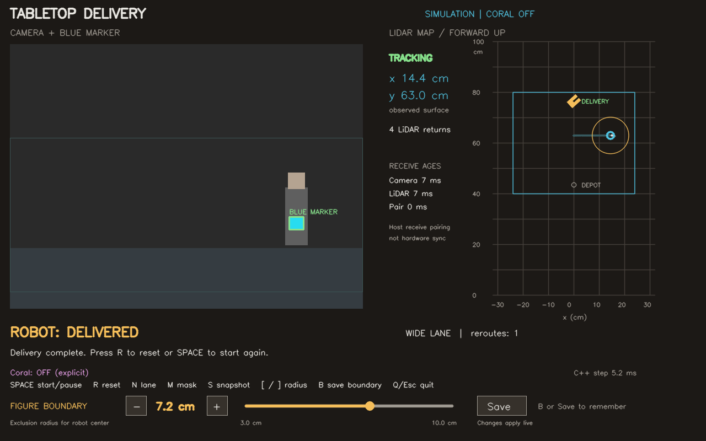
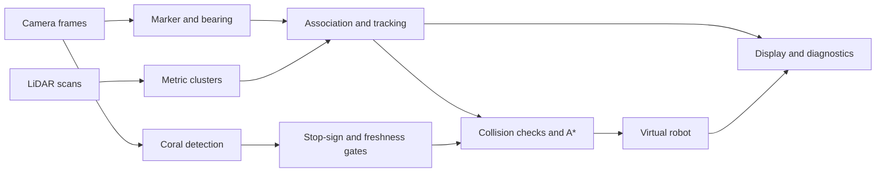

https://github.com/user-attachments/assets/d9e92878-ef92-4d8b-bfda-fc96806b2d2a


https://github.com/user-attachments/assets/7a4f45f4-07a9-4fcf-a3de-5093d7795c0a

# Tabletop Delivery

### Camera and LiDAR sensor fusion with Raspberry Pi and Coral USB

This C++ tabletop project combines a Raspberry Pi camera and LiDAR to track a movable figure and guide a virtual delivery robot that stops, yields, or reroutes around it. A Coral USB Accelerator provides object detection for cues such as stop signs, while an interactive display shows sensor data, planned routes, and an adjustable clearance boundary. The compact demo explores perception and navigation challenges relevant to sidewalk delivery robots.



*Desktop simulation with generated camera/LiDAR input and Coral disabled. The live mode uses physical sensors and USB inference.*

## Features

- Blue-marker detection associated with metric LiDAR clusters.
- Confirmed, smoothed tracking with raw observations retained for collision checks.
- Direct routing, yielding, A* detours, and holds when a passage is blocked.
- Asynchronous Coral stop-sign detection with confirmation and freshness checks.
- Live clearance slider with persistent settings.
- Camera/map display, timing indicators, CSV logs, and PNG/JSON snapshots.
- C++ application, hardware backends, simulation, and tests.

## Documentation

| Guide | Contents |
| --- | --- |
| [Reading the annotated source](docs/ANNOTATED_SOURCE.md) | Same-line comment conventions, units, ownership, guards, and test scenarios. |
| [Code walkthrough](docs/CODE_GUIDE.md) | Every source module, processing stage, state machine, ownership rule, and build component. |
| [Configuration](docs/CONFIGURATION.md) | Every JSON field, calibration procedure, units, defaults, and boundary persistence. |
| [Hardware and operation](docs/HARDWARE.md) | Physical arrangement, sensor connections, timing, controls, demo script, and troubleshooting. |
| [Testing](docs/TESTING.md) | Test suites, desktop/core builds, validation scope, and Pi checks. |
| [Dependencies](THIRD_PARTY.md) | Upstream sources, pinned model/runtime identities, and third-party notices. |

## Hardware

| Component | Role |
| --- | --- |
| Raspberry Pi 4 Model B | Acquisition, tracking, planning, rendering, and logging. |
| OV5647 camera over CSI | 640 × 480 image input for marker detection and inference. |
| RPLIDAR C1M1-R2 | Horizontal range scan through a CP2102N USB/UART adapter at 460800 baud. |
| Coral USB Accelerator | Edge TPU execution of SSD MobileNet V2 COCO. |
| Rigid plate and marked 10 cm figure | Fixed sensor geometry and a movable camera/LiDAR target. |
| 2 × 3 ft table | Compact demonstration area. |

The sensor plate stays stationary. The robot moves on screen; no drive chassis is required. The reference figure is approximately two feet from the LiDAR center and intersects a scanning window 45 mm above the tabletop.

## How it works



The camera identifies a blue/cyan marker and converts its image position to a calibrated bearing. Exactly one LiDAR cluster must match that bearing. Frames and scans are paired using host receive times. Missing, stale, or ambiguous observations hold motion.

The robot checks its entire movement segment against the figure boundary. It yields before finding a detour and stops if no route fits. Both raw and filtered figure positions constrain motion. Coral supplies a separate stop-sign gate; it does not provide the figure's metric position.

## Quick start: Raspberry Pi

The reference platform is 64-bit Raspberry Pi OS / Debian 13, OpenCV 4.10, TensorFlow Lite 2.20, and libcamera. C++20 and CMake 3.18+ are required. Clone or extract this repository, then run all commands **from its root directory**.

Install the development packages:

```bash
sudo apt update
sudo apt install -y build-essential cmake pkg-config git curl \
  libcamera-dev libopencv-dev libtensorflow-lite-dev \
  libflatbuffers-dev flatbuffers-compiler libabsl-dev \
  libusb-1.0-0-dev gdb
```

Prepare the SDK once:

```bash
mkdir -p third_party
git clone https://github.com/Slamtec/rplidar_sdk.git third_party/rplidar_sdk
git -C third_party/rplidar_sdk rev-parse HEAD
```

The final command identifies the SDK revision for your build record. Set `RPLIDAR_SDK` to use a different checkout. The Coral must be accessible to your normal user; follow the [Coral USB setup instructions](https://coral.ai/docs/accelerator/get-started/) for device access.

Build and verify the accelerator:

```bash
bash scripts/build_coral_runtime.sh
bash build_pi.sh
bash scripts/fetch_model.sh
./build/tabletop_delivery --check-coral
```

The check must finish with `PASS: USB delegate attached and model invoked in C++.` The private runtime is built against the installed TensorFlow Lite headers/library; rebuild both native components after changing TensorFlow Lite. Build concurrency defaults to two jobs and can be set with `JOBS`.

Close other applications using the sensors, then launch from the Pi desktop or a VNC session:

```bash
./build/tabletop_delivery
```

Confirm tracking before pressing Space. Calibrate your own mount using the [configuration guide](docs/CONFIGURATION.md).

## Quick start: desktop simulation

With a C++20 compiler, CMake, and OpenCV 4 development files:

```bash
cmake -S . -B build-desktop -DCMAKE_BUILD_TYPE=Release -DTABLETOP_HARDWARE=OFF
cmake --build build-desktop --parallel 2
ctest --test-dir build-desktop --output-on-failure
./build-desktop/tabletop_delivery --demo
```

These commands use a single-configuration generator on Linux. See [Testing](docs/TESTING.md) for Windows and core-only builds. Simulation does not require libcamera, the LiDAR SDK, TensorFlow Lite, a model, or a Coral.

## Controls

| Input | Action |
| --- | --- |
| Space | Start/pause or start another completed delivery. |
| R | Reset robot pose and route. |
| N | Switch wide/narrow lane and reset the robot. |
| M | Show the HSV marker mask. |
| S | Save a diagnostic snapshot. |
| Boundary slider | Change clearance live. |
| On-screen −/+ or `[`/`]` | Adjust radius by 0.1 cm. |
| Save or B | Persist the selected radius. |
| Q / Esc / window close | Quit and stop acquisition. |

The displayed exclusion radius is **figure + robot + margin**, initially **4.5 + 2.2 + 0.5 = 7.2 cm**. The standard slider range is 6.7–20.0 cm. Changes preserve pose and tracking while invalidating the route for replanning.

## Paths and run modes

All defaults are relative to the launch directory:

| Resource | Default |
| --- | --- |
| Experiment settings | `delivery_config.json` |
| Detector | `models/ssd_mobilenet_v2_coco_quant_postprocess_edgetpu.tflite` |
| Private runtime | `native_runtime/libedgetpu.so.1` |
| Session data | `delivery_runs/` |
| SDK for builds | `third_party/rplidar_sdk/` |

Configuration order is the selected config, an optional **explicit** `--tracking-config`, and the selected config's `.boundary.json` sidecar. See `--help` for path overrides.

```bash
# Bound an SSH acquisition check; headless mode auto-starts the virtual robot
./build/tabletop_delivery --headless --seconds 20

# Live camera/LiDAR with the Coral gate explicitly disabled
./build/tabletop_delivery --no-coral

# Select an experiment configuration
./build/tabletop_delivery --config delivery_config.json
```

Runs record resolved settings, state CSV, and snapshots under `delivery_runs/`. Downloads, builds, run data, and saved boundary preferences are excluded by `.gitignore`.

## Scope and validation

This is a fixed-sensor demonstration with one marked prop and a virtual robot. It does not implement physical drive control, table-edge detection, SLAM, a general occupancy map, or hardware synchronization. Unassociated LiDAR returns are display context. Camera-only detection cannot authorize motion.

The repository includes behavioral, geometric, model-parser, configuration, camera-control, and application tests. The documented desktop run passes 21 behavior cases and the planner's 252-position sweep. See [Testing](docs/TESTING.md) for the checks performed on this package and the remaining target-Pi verification. Scheduling targets and inference duration are not end-to-end performance guarantees.
