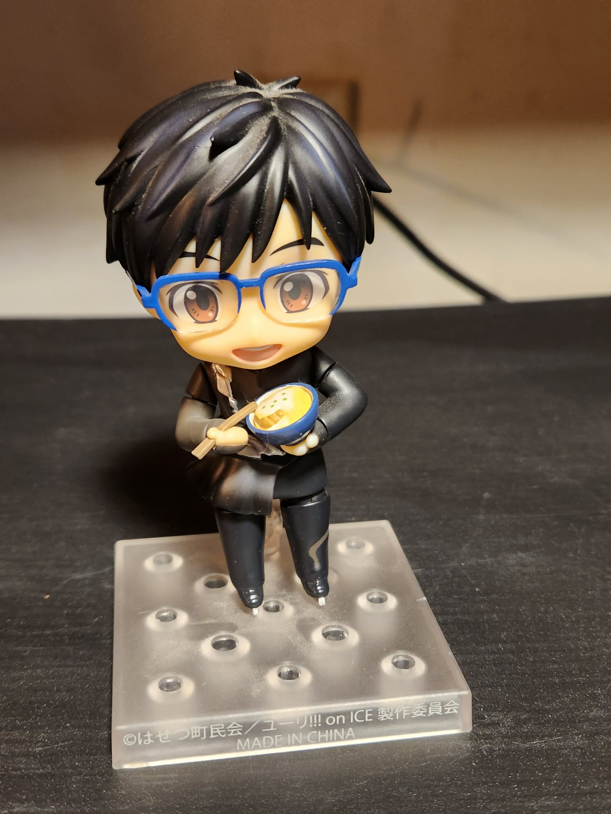
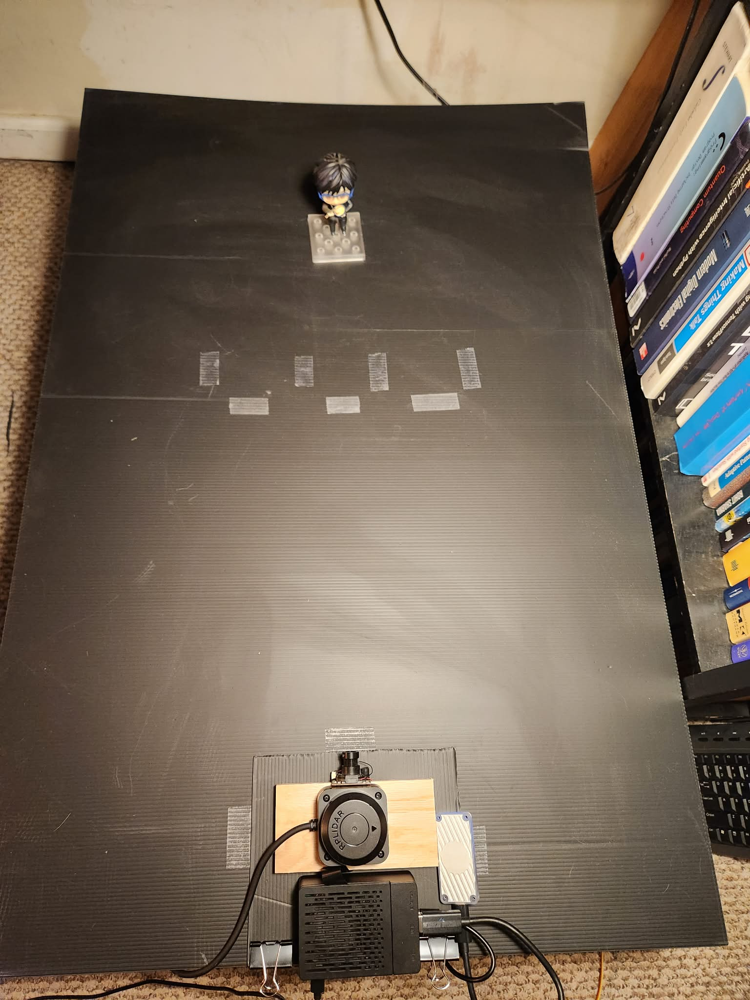
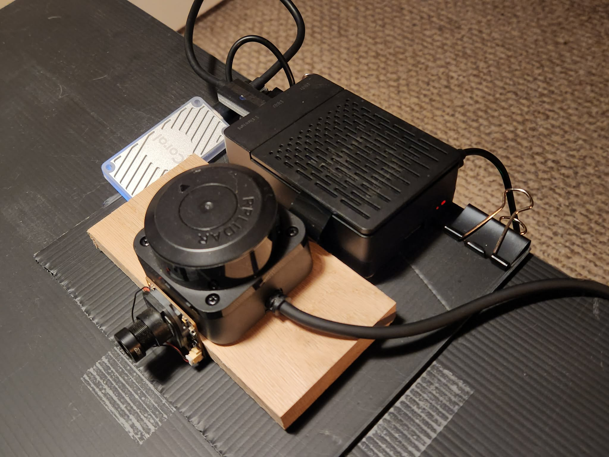
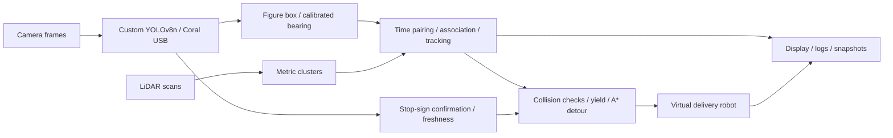

# Tabletop Delivery

### Camera and LiDAR sensor fusion with Raspberry Pi, YOLOv8n, and Coral USB

Tabletop Delivery is a C++ robotics demonstration that combines a Raspberry Pi camera, a 2D LiDAR, and a Coral USB Accelerator to track a movable figure and guide a virtual delivery robot. A custom YOLOv8n model detects the figure and a printed stop sign. Camera detections provide a calibrated bearing, LiDAR provides metric range, and the robot yields, stops, or plans a detour as the scene changes. The project fits on a 2 × 3 ft table and explores perception and navigation problems relevant to sidewalk delivery robots.

The live application—including sensor acquisition, TPU inference, detection decoding, fusion, planning, and display—is C++. Python notebooks and scripts are used for offline model preparation only.

## Physical setup

### Figure



The 10 cm figure is the movable obstacle. The custom model recognizes its appearance; a blue/cyan square is attached for camera/LiDAR calibration and optional marker comparison.

### Testbed



The 2 × 3 ft tabletop provides a compact test area. The sensor station stays fixed while the figure moves by hand. Lane boundaries and the delivery robot appear virtually in the application.

### Sensor suite



The camera and RPLIDAR share a rigid mount. The Raspberry Pi handles acquisition, fusion, planning, and rendering; the Coral USB Accelerator runs the supported portions of the object detector.

## Live demonstrations

Both recordings use the physical Raspberry Pi camera, RPLIDAR C1, and Coral USB Accelerator with the custom two-class model. Each detection has one labeled bounding box.

### Nominal and narrow lanes

The robot reroutes around the figure in the nominal lane, then repeats the delivery in the narrow lane. Hand occlusion briefly produces `TRACKING LOST`; motion resumes after the detector and LiDAR establish a valid track. **1 min 27 s.** The narrow-lane portion starts at approximately **0:59**.

https://github.com/user-attachments/assets/3236bc09-86c2-4045-8ad1-a7dd74871eaf

[Open the included lane demonstration](docs/videos/nominal-and-narrow-lanes.mp4)

### Stop-sign response

The robot begins a detour, holds when the printed stop sign is detected, then resumes and completes the delivery after the sign is removed. **36 s.**

https://github.com/user-attachments/assets/c279b3e8-50bc-4d74-aa2c-43fd69f9af98

[Open the included stop-sign demonstration](docs/videos/stop-sign-response.mp4)

## Features

- Custom YOLOv8n detection of `figure` and `stop_sign`, using INT8 inference on Coral USB.
- Figure detections associated with time-paired LiDAR clusters for metric tracking.
- Confirmation, smoothing, and freshness checks; raw positions remain available for collision checks.
- Direct routing, yielding, A* detours, and holds when a route is blocked or tracking is lost.
- Stop-sign confirmation and release timing independent of geometric obstacle avoidance.
- Adjustable **3–10 cm** figure boundary, saved through the on-screen controls.
- Default virtual robot speed of **2.24 cm/s**.
- Blue-marker calibration and an optional marker/YOLO comparison mode.
- Native camera/map display, timing indicators, CSV logs, and PNG/JSON snapshots.
- Desktop simulation and C++ tests that do not require the physical sensors.

## Hardware

| Component | Role |
| --- | --- |
| Raspberry Pi 4 Model B | Acquisition, image preparation, detection decoding, fusion, planning, and display. |
| OV5647 camera over CSI | 640 × 480 images for detection and calibration. |
| RPLIDAR C1M1-R2 | Horizontal scans through a CP2102N USB/UART adapter at 460800 baud. |
| Coral USB Accelerator | Executes the Edge TPU portion of the custom YOLOv8n model. |
| Rigid sensor plate | Maintains the measured camera/LiDAR geometry. |
| 10 cm figure and printed stop sign | Physical targets for the custom detector. |
| 2 × 3 ft table | Demonstration area; no drive chassis is required. |

The reference camera lens center is **28 mm above the tabletop**, and the LiDAR scanning window is **45 mm above the tabletop**. The figure must intersect the horizontal scan. Physical calibration places the figure's center **16 inches (40.64 cm) forward of the camera lens**, measured horizontally. The tracked LiDAR surface is not necessarily the center of the figure's base.

## How it works



**Detection and fusion.** The custom model uses class `0` for the figure and class `1` for the stop sign. The horizontal center of an eligible figure box is converted to a bearing using the saved camera/LiDAR calibration. The program pairs the detector's original source frame with a nearby scan using host receive times. Exactly one valid LiDAR cluster must match the bearing before tracking can authorize motion. A camera box alone supplies no metric distance.

**Motion decisions.** The robot checks movement segments against the figure's exclusion boundary, using raw and smoothed positions. When the direct route becomes obstructed, it yields briefly and searches for a detour. It holds when no route fits, the figure overlaps its current position, or perception is missing, stale, or ambiguous. Narrow-lane mode reduces the available planning space.

**Coral acceleration.** The Edge TPU executes supported neural-network operations. The Pi performs image preparation, the model's remaining CPU operations, output decoding, non-maximum suppression, fusion, and planning. The included model's compiler report assigns **233 operations to the TPU and 22 to the CPU**. Displayed invocation time is not end-to-end camera-to-motion latency.

**Stop signs.** A sufficiently confident, confirmed stop-sign observation holds the robot even when figure tracking is healthy. Removal releases the hold after the confirmation/release logic. This is a tabletop semantic cue, not a traffic-rule controller or a sign-distance estimate.

## Quick start: Raspberry Pi

The reference platform is 64-bit Raspberry Pi OS / Debian 13 with OpenCV 4.10, TensorFlow Lite 2.20, and libcamera. Use a C++20 compiler and CMake 3.18 or newer. Run the following commands **from the repository root**.

### 1. Install dependencies and the LiDAR SDK

```bash
sudo apt update
sudo apt install -y build-essential cmake pkg-config git curl \
  libcamera-dev libopencv-dev libtensorflow-lite-dev \
  libflatbuffers-dev flatbuffers-compiler libabsl-dev \
  libusb-1.0-0-dev gdb

mkdir -p third_party
git clone https://github.com/Slamtec/rplidar_sdk.git third_party/rplidar_sdk
git -C third_party/rplidar_sdk rev-parse HEAD
```

Record the SDK revision. Set `RPLIDAR_SDK` to reuse an existing checkout. Follow the [Coral USB setup instructions](https://coral.ai/docs/accelerator/get-started/) for normal-user device access.

### 2. Build and check the included custom model

The compiled model, labels, checksum, and export manifest are included under `models/`. Retraining or export is not required to run the supplied figure detector.

```bash
bash scripts/build_coral_runtime.sh
bash build_pi.sh
(cd models && sha256sum --check figure_yolov8n_320_edgetpu.sha256)
./build/tabletop_delivery --yolo-profile figure --check-coral
```

The last command must report `PASS: USB delegate attached and model invoked in C++.` The private Coral runtime is built against the installed TensorFlow Lite headers/library; rebuild it and the application after changing TensorFlow Lite. `JOBS` controls build concurrency, which defaults to two.

### 3. Calibrate the camera and LiDAR

Attach the blue/cyan square for calibration. Close other sensor applications and use the Pi desktop or VNC:

```bash
./build/tabletop_delivery --calibrate
```

Place the figure's center 16 inches forward of the camera lens. Capture center, left, and right positions on that same forward row. Select the figure's LiDAR cluster, wait for 20 stable paired samples, and press **Space** for each position. Accepting the third pose automatically saves and activates the calibration. See the [calibration guide](docs/CALIBRATION.md) for the physical procedure.

Normal startup uses the last activated calibration, then `calibration_16in.json` if present, then `delivery_config.json`. An explicit `--config FILE` overrides that choice. The supplied seed anchors are not a substitute for measuring your sensor mount.

### 4. Run the figure detector

```bash
./build/tabletop_delivery --yolo-profile figure --tracking yolo
```

Confirm a single `figure` box and a valid LiDAR position, then press **Space**. The camera heading identifies `YOLO FIGURE`; the box label includes confidence. This mode uses the detector for the visual observation and does not fall back to the blue marker. The supplied recordings demonstrate this figure without the square; different poses, lighting, props, or backgrounds require further evaluation.

To compare against the blue marker while it remains attached:

```bash
./build/tabletop_delivery --yolo-profile figure --tracking compare
```

Comparison mode uses marker fusion to control the robot and runs the YOLO track alongside it for diagnostics. It shows the independent green marker box and purple detector box. Detector-control mode draws each detection once.

## Model and run modes

| Mode | Command/options | Behavior |
| --- | --- | --- |
| Custom figure control | `--yolo-profile figure --tracking yolo` | Figure detector supplies bearing; LiDAR supplies range; custom stop-sign gate is active. |
| Custom comparison | `--yolo-profile figure --tracking compare` | Marker controls the robot; YOLO is measured alongside it. |
| Marker with custom sign detector | `--yolo-profile figure --tracking marker` | Blue marker supplies bearing; custom model supplies stop-sign observations. |
| Stock COCO person evaluation | `--yolo-profile coco --tracking compare` | Requires a separately exported COCO model; not trained for the miniature figure. |
| Marker with SSD | No detector/tracking flags | Default CLI behavior; first run `bash scripts/fetch_model.sh` to download SSD. |
| Desktop simulation | `--demo` | Generated sensor data, marker tracking, and Coral disabled. |

The custom figure threshold defaults to **0.25**; use `--target-confidence` to change it. The stop-sign score threshold is **0.60**. `--model FILE` selects another compiled model with the selected profile's tensor and class contract. A PyTorch `.pt` file cannot run directly in the C++ application.

See [the model guide](docs/FIGURE_MODEL.md) for the 60-training/18-validation-image experiment, conversion, tensor formats, and accuracy results. The held-out images came from the same recording; those metrics do not establish general performance in new scenes.

## Controls

| Input | Action |
| --- | --- |
| Space | Start/pause, or start another completed delivery. |
| R | Reset robot pose and route. |
| N | Switch nominal/narrow lane and reset the robot. |
| M | Show the HSV marker mask in marker/comparison mode. |
| S | Save a diagnostic snapshot. |
| Boundary slider, −/+, or `[`/`]` | Change radius live, in 0.1 cm increments. |
| Save or B | Persist the selected radius. |
| Q / Esc / window close | Quit and stop acquisition. |

The figure boundary ranges from **3.0 to 10.0 cm**, starting at **7.2 cm** unless a saved value is selected. It is the complete exclusion distance from the tracked figure position to the robot's center; another robot radius is not added. Changing it preserves pose and tracking while requiring route replanning. It represents a chosen demo clearance, not a measured figure footprint.

## Desktop simulation and tests

With a C++20 compiler, CMake, and OpenCV 4 development files:

```bash
cmake -S . -B build-desktop -DCMAKE_BUILD_TYPE=Release -DTABLETOP_HARDWARE=OFF
cmake --build build-desktop --parallel 2
ctest --test-dir build-desktop --output-on-failure
./build-desktop/tabletop_delivery --demo
```

Simulation requires no camera, LiDAR SDK, TensorFlow Lite, model, or Coral. It exercises the marker-based synthetic scene rather than simulating neural-network accuracy. See [Testing](docs/TESTING.md) for Windows and core-only builds. The merged package passes **11 desktop CTest entries**, including detector decoding and the single-box overlay regression.

## Documentation and source

| Guide | Contents |
| --- | --- |
| [Code walkthrough](docs/CODE_GUIDE.md) | Acquisition, inference, fusion, planning, display, ownership, and build components. |
| [Annotated source](docs/ANNOTATED_SOURCE.md) | Same-line comments, units, guards, and suggested reading order. |
| [Custom model](docs/FIGURE_MODEL.md) | Figure/stop-sign model, training evidence, export, and C++ integration. |
| [Detector comparison](docs/YOLO_EVALUATION.md) | Tracking modes, stock COCO export, thresholds, and comparison logs. |
| [Configuration](docs/CONFIGURATION.md) | JSON fields, defaults, units, and boundary persistence. |
| [Calibration](docs/CALIBRATION.md) | Three physical poses, sensor origins, capture validation, and activation. |
| [Hardware and operation](docs/HARDWARE.md) | Mounting, connections, demo sequence, and troubleshooting. |
| [Testing](docs/TESTING.md) | Automated checks and physical acceptance checks. |
| [Model files](models/README.md) | Bundled model identity and optional SSD download. |
| [Dependencies and notices](THIRD_PARTY.md) | Upstream software, model provenance, and licensing links. |

The main components are `src/sensors.cpp` for acquisition, `src/coral_engine.h` and `src/coral.cpp` for inference, `src/yolo.h` for decoding, `src/evaluation.h` for detector/scan pairing and comparison, `native/core.cpp` for fusion and planning, and `src/view.cpp` for rendering. Offline export tools are under `scripts/`.

## Records and scope

Sessions under `delivery_runs/` contain resolved configuration, state CSV, and snapshots. Detector/comparison runs also record inference timings, track agreement, and model/profile settings. Builds, SDK/runtime downloads, local calibration, boundary preferences, and run logs are excluded from Git. The supplied custom model and demonstration assets are deliberately tracked.

This is a fixed-sensor, single-figure demonstration with a virtual robot. It does not implement physical drive control, table-edge detection, SLAM, a general occupancy map, or hardware synchronization. Unassociated LiDAR points provide display context. The videos demonstrate the supplied props in one setup; they do not establish general pedestrian detection, autonomous navigation safety, or a measured CPU-versus-TPU speedup.
