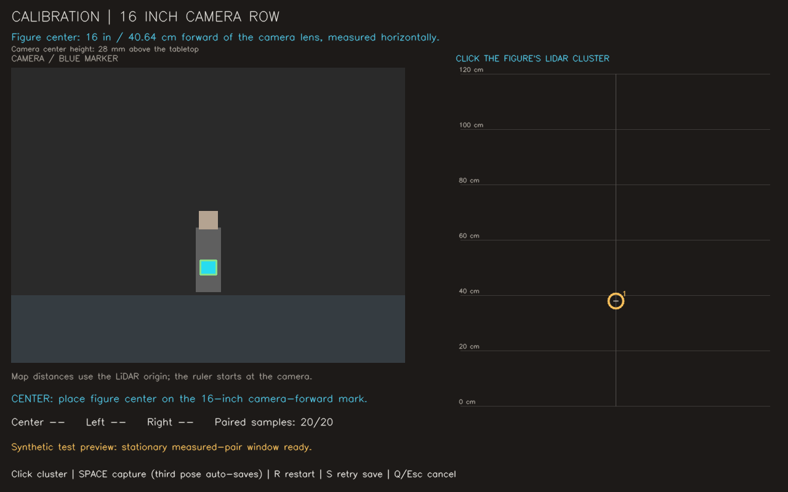

# Calibration at 16 inches from the camera

The capture workflow measures three camera/LiDAR anchor pairs with the figure on a row **16 inches (40.64 cm) forward of the camera lens**. The camera lens center is **28 mm above the table surface**. Use the figure's center projected onto the tabletop as the placement point and the point directly below the lens as the ruler's starting location. Measure the 16-inch distance horizontally along the tabletop.

The camera and LiDAR have different origins. LiDAR reports the surface struck by its scan, which can also differ from the figure's center. The software keeps those measured surface ranges; it does not force them to read 40.64 cm or apply the 28 mm camera height as a range correction. The capture window and saved files record both setup measurements. Ruler placement is performed by the user and cannot be verified from the available sensor data alone.

## Physical placement

Keep the camera/LiDAR plate fixed and the figure upright, with its body crossing the horizontal scanning window. Keep the figure facing the same direction for all three captures. Mark the center point on the table, then place left and right markers about 10 cm to either side on the same forward row:

```text
         LEFT          CENTER          RIGHT
           o----10 cm-----o-----10 cm------o
                         |
                         | 40.64 cm forward
                         |
                     camera lens
```

Align CENTER straight ahead of the camera. Slide sideways along the marked row for LEFT and RIGHT, keeping the forward distance fixed. The program measures the actual bearings, so the lateral offsets do not need to be exactly 10 cm; the marker must remain visible and the three positions must be well separated.

## Capture the three poses

Close the delivery window so it releases the camera and LiDAR. Run from the project directory on the Pi desktop or through VNC:

```bash
./build/tabletop_delivery --calibrate
```

The calibration window starts camera/LiDAR acquisition without loading a detector model or commanding virtual robot movement. It detects marker and LiDAR candidates independently; it does not use the seed camera-bearing map to choose the target.

1. **Center:** put the figure's center at the 16-inch camera-forward mark. Identify its green LiDAR cluster on the right panel. Briefly moving the figure before settling can help distinguish it from background returns. Remove your hand and click that cluster.
2. Wait for **20 paired samples** and the **Stable capture ready** message. This typically takes several seconds. Press **Space** to accept the pose.
3. **Left:** slide the figure about 10 cm left along the row. Remove your hand, click its cluster again, wait for stable samples, and press **Space**.
4. **Right:** move about 10 cm right of the center mark on the same row. Select the cluster, wait, and press **Space**.
5. Accepting the right-hand pose automatically validates, saves, and activates the calibration, then closes the capture window. No separate save key is required. If saving fails, the window retains the measurements: **S** retries and **R** restarts capture. **Q/Esc** cancels the capture window.



The illustration uses synthetic observations for display testing. Your live camera image and LiDAR clusters will differ.

A capture requires one blue marker, one compact cluster near the manually selected location, and fresh paired observations. Each scan and camera frame contributes at most once. The rolling window must span no more than 8 pixels of horizontal marker motion and 12 mm of surface-position spread. Missing or ambiguous observations clear that window. Keep other blue objects out of view, and keep fingers clear of the scan plane.

## Saved files and running the delivery

Saving creates:

- `calibration_16in.json`: a complete usable configuration with measured forward direction, camera-bearing anchors, the 0.4064 m horizontal reference, and `camera_center_height_m: 0.028`.
- `calibration_16in.json.measurements.json`: the same camera geometry plus the measured marker column, raw LiDAR bearing, observed range, and sample count for each pose.
- `active_calibration.json`: the selected calibration filename, used automatically by normal startup.
- A capture session under `delivery_runs/calibration_16in/`, containing camera images, raw scan CSVs, and diagnostic snapshots for the accepted placements.

Run with the measured calibration:

```bash
./build/tabletop_delivery
```

Use a different destination for another capture session:

```bash
./build/tabletop_delivery --calibrate --calibration-output calibration_16in_second.json
```

Each successful capture becomes the active default, including a custom `--calibration-output` filename. Reusing an output filename replaces the completed calibration after validation; the previous configuration and measurements are retained as uniquely named `.backup.*` files. Configuration and activation files are written through temporary siblings and published by rename, so startup never reads a partially written configuration. Incomplete or invalid captures are not published. If activation fails after the configuration was saved, S retries saving and activation with the retained measurements; the terminal reports the error.

Startup first honors an explicit `--config FILE`. Without that argument it loads the file named in `active_calibration.json`; if no activation record exists, it uses `calibration_16in.json` when present, then falls back to `delivery_config.json`. This also makes an existing default-name calibration usable immediately after installing the update. A missing or malformed active calibration produces an error instead of silently using seed alignment. To deliberately use or recalibrate from the seed settings, pass `--config delivery_config.json`.

The newly saved configuration retains the selected figure boundary, including the 3–10 cm controls, and the robot's lane, depot, and delivery settings. Observation bounds expand as needed to include the measured closer row and larger marker. Saving boundary preferences during a calibrated run creates a sidecar next to the automatically selected calibration file.

Verify the resulting alignment at intermediate positions on the row before starting a delivery. Correct alignment means the marker matches the figure's observed LiDAR surface, not that the displayed range equals the camera-to-center ruler measurement. Move the figure away from the virtual robot's starting exclusion zone before pressing Space.

## What is computed

The CENTER capture supplies a circular mean of raw LiDAR bearings to define forward. LEFT and RIGHT supply measured horizontal marker centroids and their relative LiDAR bearings. These three pairs define the piecewise-linear association map used by normal tracking. The program rejects incomplete, reversed, insufficiently separated, or substantially different-depth captures.

This is a local camera-to-2D-LiDAR bearing calibration for the reference row. It does not estimate complete camera intrinsics/extrinsics, identify the geometric center from a surface return, or eliminate parallax at every depth. Recalibrate after moving the sensor mount, changing camera focus/crop, or selecting a substantially different working distance.
