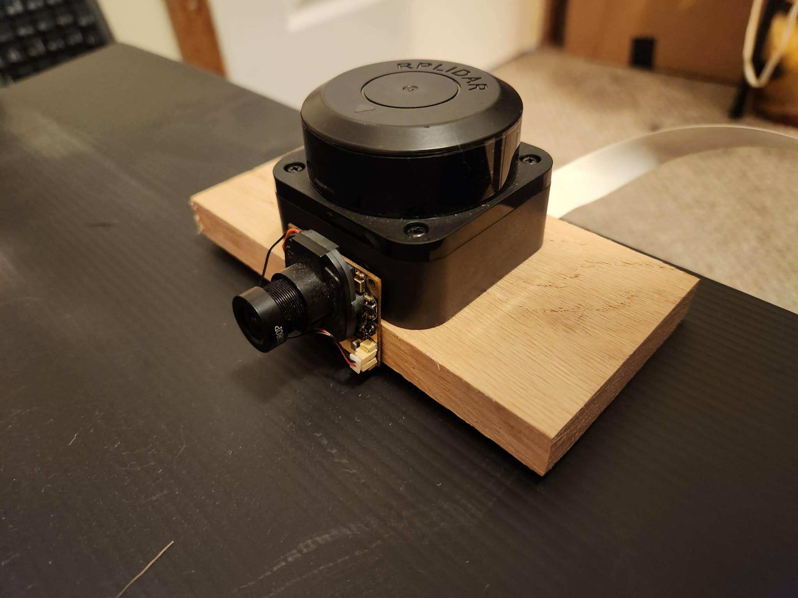

# Hardware and operation

## Fixed sensor station



The camera connects to the Pi over CSI. The C1 LiDAR uses a CP2102N USB-to-UART adapter, and Coral uses a separate USB connection. Secure both sensors to the same plate. Stable power, strain-relieved cables, and an unobstructed scanning sector make the short demo repeatable.

The reference setup uses a 2 × 3 ft table, a 10 cm figure, a **camera lens-center height of 28 mm**, and a measured LiDAR scanning-window height of 45 mm above the table. For calibration, place the figure's center **16 inches (40.64 cm) forward of the camera**, measured horizontally from the point directly below the lens along the tabletop. The figure's body must intersect the horizontal scan. Keep the plate fixed and move only the figure. The [calibration workflow](CALIBRATION.md) measures new camera/LiDAR anchor pairs at this row; camera height and horizontal reference are separate from the LiDAR's observed surface distance.

Before launching, check camera and serial enumeration:

```bash
rpicam-hello --list-cameras
ls -l /dev/serial/by-id/
```

Select `--camera-index N` or `--port PATH` if required. The LiDAR baud rate is fixed at 460800 in the acquisition backend. If serial access is denied, check the device's owner/group and your account's permissions. Follow the [Coral setup guide](https://coral.ai/docs/accelerator/get-started/) for USB access. The application is intended to run as a normal user.

## What the display means

The left panel shows the camera frame chosen for the displayed scan, its marker box, or the threshold mask. The right panel shows raw scan context, configured tracking/lane rectangles, selected figure position, trail, route, depot, and goal. The amber circle is the selected total exclusion radius for the robot center, adjustable from 3 to 10 cm.

Camera and scan ages are host receive ages. The pair difference is their receive-time offset. Neither value proves synchronized exposure/scanning. The inference duration measures interpreter invocation and is not complete camera-to-decision latency.

The main robot state explains the active decision: ready, paused, driving/rerouting, yielding, blocked, too close, tracking lost, TPU offline, stop sign, or delivered. A position displayed in the interface is a measured LiDAR surface, not necessarily the base center.

## Short demonstration

Prepare the model/runtime and calibration before the presentation; setup and compilation are not part of the live walkthrough.

| Time | Action | Observation |
| --- | --- | --- |
| 0–15 s | Place the figure beside the route; confirm tracking and Coral health. | Stable marker and metric position. |
| 15–35 s | Press Space and move the figure toward the wide lane. | Yield and detour, or hold if overlapping. |
| 35–55 s | Increase and reduce boundary radius. | Circle and route constraints update without resetting pose. |
| 55–75 s | Press N, then Space; center the figure in the narrow lane. | Hold when blocked; resume as space opens. |
| 75–95 s | Cover, then uncover the marker. | Tracking hold followed by confirmation and recovery. |
| 95–110 s | Save the radius and press S. | Persisted preference and a diagnostic snapshot. |

A printed stop sign can substitute for a step after confirming reliable recognition. The stock detector is not specifically trained on miniature signage. Move the figure slowly near the calibrated distance.

## Run records

Each run directory contains:

- `effective_config.json`: resolved settings at startup.
- `session.json`: live/simulation mode, Coral requirement, and timing convention.
- `delivery.csv`: states, positions, route count, timestamps, inference state, and boundary radius.
- `snapshot_N/preview.png`: rendered display.
- `snapshot_N/camera.png`: paired input image when available.
- `snapshot_N/lidar.csv`: raw angle/range/quality observations.
- `snapshot_N/state.json`: structured state, validity flags, path, and detections.

Snapshots capture the program's inputs and decision state, not synchronized ground truth. The application does not currently replay captured sessions.

## Troubleshooting

| Symptom | Action |
| --- | --- |
| Camera busy/unavailable | Close other capture software; inspect CSI connection and camera index. |
| No marker | Use M; check marker color, lighting, ROI, and component limits. |
| Ambiguous or unstable position | Check the three bearing anchors, scan-plane intersection, and calibrated distance. |
| No LiDAR scan | Inspect serial link, permissions, baud rate, and explicit port selection. |
| TPU startup fails | Run `--check-coral`; inspect the private library path, ABI message, USB access, and power. |
| Saved boundary seems unexpected | Inspect the active configuration path and its `.boundary.json` sidecar. |
| No GUI over SSH | Use Pi desktop/VNC, or run `--headless --seconds 20`. |

`bash scripts/diagnose.sh` prints package/device/library information. `bash scripts/debug_coral.sh` captures a debugger trace of Coral-only initialization. A failure during live acquisition needs the live executable path:

```bash
gdb -q -batch -ex run -ex "thread apply all bt 15" \
  --args ./build/tabletop_delivery --headless --seconds 10 \
  > native_live_debug.txt 2>&1
```

Device inventories and diagnostic logs can contain machine identifiers. Inspect any run data you choose to publish; these generated files are excluded from the repository by default.
