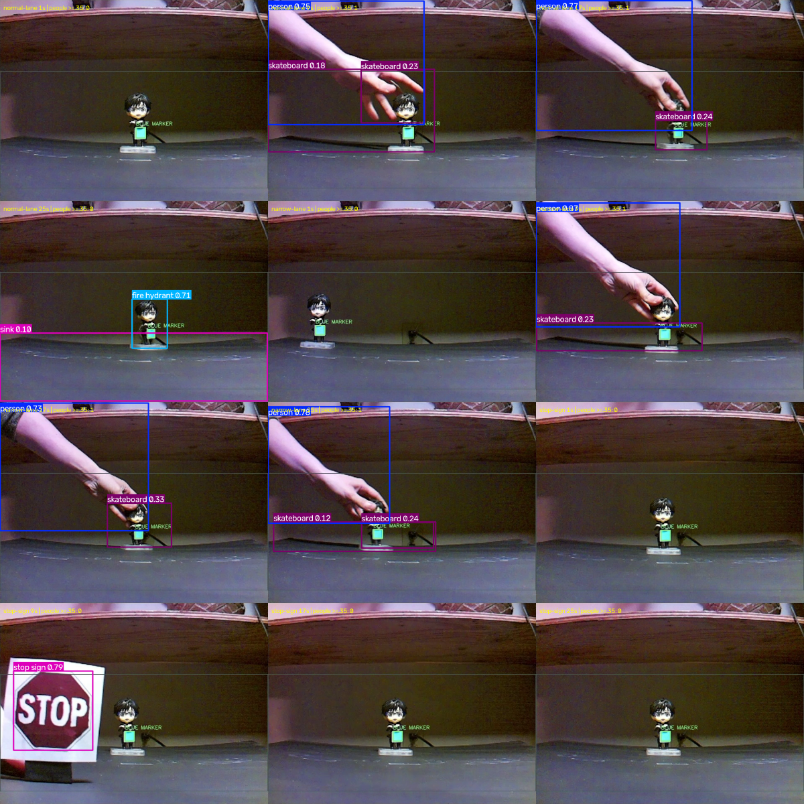

# Stock YOLOv8n recording preflight

On November 20, 2026, the stock YOLOv8n COCO-80 model was evaluated on the camera portions of three supplied screen recordings. The model was run locally with Ultralytics 8.3.228, float32 CPU inference, 320×320 letterboxed input, 0.35 person confidence, and class-aware NMS at 0.45 IoU. One frame was sampled every two seconds, starting at one second.

| Recording | Sampled frames | Frames with a person detection ≥0.35 | Frames with an eligible tabletop-size person |
| --- | ---: | ---: | ---: |
| Normal lane | 17 | 6 | 0 |
| Narrow lane | 17 | 8 | 0 |
| Stop-sign response | 16 | 0 | 0 |
| Total | 50 | 14 | 0 |

The visible person boxes in the inspected examples surround the operator's moving hand/arm. The figure is often undetected; one example labels it as a fire hydrant. A printed stop sign is recognized in the displayed stop-sign example. These results support keeping person tracking experimental and collecting figure-specific training data before relying on it.

The tabletop-size gate allows a box width of at most 30% of the camera frame and a height of at most 65%. It rejects the broad arm detections in this sample. It is a geometric filter, not evidence that any remaining detection is the intended figure.

The montage shows four times per recording: 1, 9, 17, and 25 seconds. Displayed diagnostic boxes use a lower 0.10 floor to expose alternative classifications; the table uses the actual 0.35 person threshold.

## Reproducibility and limits

- Model: stock `yolov8n.pt` from the [Ultralytics v8.3.0 assets release](https://github.com/ultralytics/assets/releases/tag/v8.3.0).
- Weight SHA-256: `f59b3d833e2ff32e194b5bb8e08d211dc7c5bdf144b90d2c8412c47ccfc83b36`.
- Normal/narrow camera crop: `[x=204, y=199, width=640, height=480]` in the 1680×1050 recordings.
- Stop-sign camera crop: `[x=224, y=207, width=640, height=480]`.
- Source recordings: `2026-11-20 03-57-04.mp4`, `2026-11-20 03-58-34.mp4`, `2026-11-20 08-07-48.mp4`.
- [Per-frame predictions and settings](yolo-preflight.json) retain class names, confidence scores, and pixel boxes.
- The recordings include the blue square and UI overlays. This is not an evaluation of clean marker-free camera frames.
- No hand-labeled ground truth was used, so the table is detection presence rather than precision, recall, or figure-recognition accuracy.
- CPU float32 results do not establish INT8 accuracy, Coral latency, camera/LiDAR synchronization, or live robot behavior.

The next useful measurement is the live `--tracking compare` run with the exported INT8 model. See [the evaluation guide](YOLO_EVALUATION.md).
